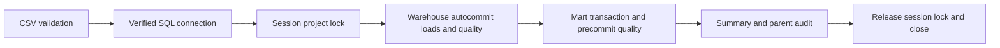

# Faza 4B: koordinisani end-to-end tok

Jedna komanda poziva postojeće funkcije: CSV validacija -> Bronze -> Silver -> warehouse quality gate
-> mart refresh -> mart precommit quality/reconciliation -> završni sažetak. `crm_incremental` demo nije
deо toka. Izvorna CSV pravila, SQL transformacije, oba quality registra i mart SQL model nisu kopirani.

`e2e_pipeline.runner.run` poziva `warehouse_pipeline.runner.run_report` i `mart_pipeline.runner.run`
direktno, bez subprocess/shell CLI poziva. Stari `warehouse_pipeline.run_pipeline` i dalje vraća exit code;
novi structured API vraća postojeći warehouse izveštaj. Child rezultati su ugrađeni u jedan parent JSON.

## Svakodnevne komande

Iz korena projekta, sa postojećom .venv:

```powershell
$target = @('--server', 'DESKTOP-N1402MQ\SQLEXPRESS', '--expected-server', 'DESKTOP-N1402MQ\SQLEXPRESS', '--database', 'DataWarehouse', '--trust-server-certificate')

# Jednokratna eksplicitna audit migracija; već izvršena u fazi 4B.
.\.venv\Scripts\python.exe -m e2e_pipeline.migrate @target

# Validira CSV i prikazuje plan; ne otvara SQL konekciju.
.\.venv\Scripts\python.exe -m e2e_pipeline --dataset-root .\datasets --dry-run --report-path ('.\reports\e2e-dry-' + [guid]::NewGuid() + '.json')

# Namerno ponavlja postojeći Bronze/Silver TRUNCATE/full-load i zatim mart refresh.
.\.venv\Scripts\python.exe -m e2e_pipeline @target --dataset-root .\datasets --execute --report-path ('.\reports\e2e-run-' + [guid]::NewGuid() + '.json')
$LASTEXITCODE
```

Podrazumevan je dry-run. --execute i --dry-run su međusobno isključivi. Execute zahteva server, database
i expected-server; dataset-root je potreban u oba režima. Konfiguracija koristi postojeće DW_SERVER,
DW_DATABASE, DW_EXPECTED_SERVER, DW_DATASET_ROOT, DW_SQL_DATASET_ROOT i DW_ODBC_DRIVER defaults.
--sql-dataset-root je putanja vidljiva SQL Server-u, default resolved lokalni dataset-root. Per-connection
certificate trust ne menja globalne postavke ili kredencijale. Izlaz je 0 za PASS, 1 za runtime FAIL,
2 za neispravne CLI opcije. Nema automatskog retry-a niti environment prečice koja uključuje execute.

Izveštaj se rezerviše pre posla: novi .json van datasets. Postojeći se ne prepisuje osim uz eksplicitni
--overwrite-report. Novo UUID ime sprečava slučajno korišćenje starog report-a. reports/ ostaje ignorisan
u Git-u. Normalni run ne izvršava DDL/migraciju i zahteva prethodno postavljen audit i mart.

## Jedna konekcija i vlasništvo nad lock-om



Zajednički resource je **datawarehouse.pipeline.v1**, SQL application lock, Exclusive, Session owner,
DbPrincipal public, scoped na ciljnu bazu/instancu. Default timeout je 10000 ms; E2E --lock-timeout-ms
prihvata 0–60000. Negativan sp_getapplock rezultat je FAIL pre prve load mutacije, nikada nastavak bez
zaštite. CSV validation prvo završi; tek tada se otvara i potvrđuje SQL konekcija.

Parent kreira lazy `ProjectSession`. Warehouse child otvara tu jednu konekciju i uzima lock nakon target
check-a. Mart child pozajmljuje ISTU konekciju, proverava isti cilj i ne uzima isti session lock ponovo.
Child funkcije zatvaraju samo svoje kursore. Parent drži lock kroz oba child posla, sažetak i audit
finalizaciju; u finally ga oslobađa i zatvara konekciju. JSON finalizacija koristi već sačuvane rezultate,
bez novih poslovnih SQL čitanja posle oslobađanja. Ako release padne, report je FAIL i connection close
ostaje fallback za oslobađanje session lock-a. Originalna greška ostaje u child/parent izveštaju.

Samostalni warehouse (uključujući quality-only audit/čitanje) i samostalni mart runner uzimaju isti lock
na svojoj konekciji i oslobađaju ga u finally. Svi podržani Python Bronze/Silver writer ulazi idu kroz
warehouse funkciju. Samostalni mart refresh zato ne može da uđe između zaštićenih warehouse koraka.
End-to-end nema zasebnu lock-owning konekciju koja bi blokirala sopstveni child writer.
Postojeći transaction-owned mart.loader.v1 lock ostaje unutrašnja zaštita mart procedure, sa doslednim
redosledom: project session lock, pa mart transaction lock. CRM-demo lock ostaje odvojen.

Application lock je kooperativan protokol: **direktni SSMS SQL pozivi Bronze/Silver/mart procedura bez
istog session lock-a nisu zaštićeni**. Ne pokretati ih paralelno sa E2E tokоm. Ako je ručni SQL nužan,
uzeti isti resource sa Session ownership-om u istoj konekciji, proveriti return code i uvek osloboditi.
Drugе aplikacije koje direktno pišu Silver ne postaju automatski deo protokola.

## Transakcione granice i failure stage

Full-load i dalje radi sa autocommit=True i postojećim TRUNCATE/INSERT procedurama. Nema rollback-a
celog warehouse-a ili celog E2E toka. Bronze failure sprečava Silver, warehouse ERROR sprečava mart;
WARNING sam dozvoljava nastavak. Unreached parent koraci su SKIPPED sa duration=0 i bez child_run_id.

Mart i dalje otvara svoju jednu SERIALIZABLE transakciju, osvežava dims/fact, izvršava sve postojeće
mart quality provere i COMMIT tek kada nema kritičnog nalaza. Session project lock preživljava i mart
COMMIT i ROLLBACK. Warehouse PASS + mart FAIL -> parent FAIL, prethodno objavljeni mart ostaje, a već
završene warehouse promene nisu vraćene. Gold može već prikazivati nov Silver dok mart ostaje stariji.

failure_stage navodi warehouse.validation/connection/target_check/coordination/bronze/silver/quality,
mart, summary, audit ili report/coordination_release. Ako mart commit uspe a naknadni summary/audit/JSON
padne, parent je FAIL, ali child committed=True ostaje vidljiv; to nije dokaz da mart nije objavljen.
Gubitak veze u COMMIT potvrdi može ostaviti committed=null/nepoznat ishod. Proveriti bazu pre novog rada.

## Parent/child audit i JSON

`scripts/audit/phase4b_migration.sql` je eksplicitna additive migracija: pipeline_runs dobija parent_run_id
(self-FK), component (warehouse/mart/e2e), failure_stage i summary_json, uz parent index i JSON check.
Stari redovi ostaju sa istim run_id/statusom i default component=warehouse. Postojeće steps/quality
strukture ostaju iste. Migracija ne dira druge šeme; nekompatibilne kolone se odbijaju.

Parent UUID povezuje postojeći warehouse child run i mart child report. Parent audit počinje tek nakon
potvrde cilja i uspešnog lock-a, pre load-a. Warehouse zadržava svojih 9 step i 28 check audit rezultata.
Mart child dobija linked run i step audit zapis sa svojim stvarnim vremenima/statusom; detaljne mart
provere ostaju u embedded JSON-u. Ne upisuju se decimalne revenue metrike u postojeće bigint metric_value
kolone. Aggregate sažetak čuva se u parent summary_json. Parent audit ima warehouse/mart/summary korake.

Jedan JSON čuva run_id, child run_id/parent_run_id, kompletne child izveštaje, UTC vremena, monotonic
trajanja, PASS/FAIL/SKIPPED, failure_stage, findings i sažetak. Parent i child UUID-jevi podudaraju se
sa audit zapisima. Raw SQL driver tekst, stvarna imena kupaca i kredencijali nisu zapisani.
CSV newline upozorenje ostaje u warehouse.csv_results; parent findings prikazuje SQL WARNING/ERROR.

Nedostupna konekcija, loš CSV ili target/lock failure mogu ostaviti samo lokalni report, bez parent SQL
audit-a. Process kill može ostaviti RUNNING parent i child warehouse evidenciju. Mart child audit se
finalizuje nakon povratka njegovog runner-a; prekid u samoj mart obradi zato može zahtevati pregled
modela/reconciliation-a, umesto pretpostavke na osnovu nepostojećeg child zapisa. Audit/report greške
ne pretvaraju izvršavanje u potpuni uspeh i ne sakrivaju prethodnu failure stage.

## Sažetak prodaje i unknown politika

Sažetak se čita dok isti project lock ostaje zauzet: sales_rows, quantity, revenue, matched/current/
historical product rows i historical share od SVIH prodajnih redova. unknown_by_reason daje broj,
količinu i iznos svake unknown grupe. Historical coverage se ne deli samo brojem matching prodaja.

Unknown proizvodi **ostaju uključeni u ukupan prihod**, ali nemaju pouzdane istorijske atribute ili
trošak. Ne koristiti current product cost kao proizvoljnu zamenu za računanje istorijske marže.
Nedostajući order datum i pre-source istorija ostaju dokumentovana ograničenja izvora. Mart U02/U07
opisuju istih 19 zapisa u različitim role-ama; counts iz pojedinačnih quality warning-a nisu aditivni.

## Oporavak bez automatskog retry-a

| Failure stage | Postupak |
| --- | --- |
| CSV validation | Ispraviti dostupnost/ugovor ulaza, pregledati validator i ponoviti dry-run. Nije bilo SQL load-a. |
| Connection/target/lock | Proveriti instance/bazu, Windows pristup i da li drugi podržani writer radi. Ne menjati globalna podešavanja zbog jedne greške. |
| Bronze/Silver | Pregledati lokalni report/audit i moguće delimično stanje. Ne pretpostaviti rollback. Odlučiti o jednom kontrolisanom ponavljanju tek posle dijagnoze. |
| Warehouse quality ERROR | Pregledati pravilo i anomalije. Mart je SKIPPED; ne menjati podatke/pravila samo da gate prođe. |
| Mart FAIL posle warehouse PASS | Potvrditi warehouse quality i source stanje, pa po potrebi pokrenuti samo samostalni mart refresh. Ne ponavljati Bronze/Silver automatski. |
| Summary/audit/report posle mart commit-a | Proveriti child committed i SQL model. Obnoviti observability evidence bez pretpostavke da treba ponovno full-load učitavanje. |

Za read-only warehouse gate i zaseban mart oporavak, sa prethodno definisanim $target:

```powershell
.\.venv\Scripts\python.exe -m warehouse_pipeline @target --quality-only --report-path ('.\reports\recovery-quality-' + [guid]::NewGuid() + '.json')
.\.venv\Scripts\python.exe -m mart_pipeline @target --execute --report-path ('.\reports\recovery-mart-' + [guid]::NewGuid() + '.json')
```

Druga komanda je nameran mart refresh; koristiti je tek nakon pregleda neuspeha. Originalni parent FAIL
ostaje istorijski zapis; novi report dobija svoj run_id. Ne prepisivati stari report da bi izgledao uspešno.

SSMS pregled poslednjeg E2E izvršavanja:

```sql
USE DataWarehouse;
DECLARE @parent uniqueidentifier = (
 SELECT TOP(1) run_id FROM audit.pipeline_runs WHERE component='e2e' ORDER BY started_at_utc DESC
);
SELECT run_id,parent_run_id,component,status,started_at_utc,ended_at_utc,failure_stage,error,summary_json
FROM audit.pipeline_runs WHERE run_id=@parent OR parent_run_id=@parent ORDER BY started_at_utc;
SELECT * FROM audit.pipeline_steps WHERE run_id=@parent ORDER BY ordinal;
SELECT q.* FROM audit.quality_results q JOIN audit.pipeline_runs r ON r.run_id=q.run_id
WHERE r.parent_run_id=@parent ORDER BY r.component,q.check_id;
```

## Testovi i sledeća Airflow faza

```powershell
.\.venv\Scripts\python.exe -m pytest -q
$env:DW_RUN_PROJECT_LOCK_INTEGRATION='1'
.\.venv\Scripts\python.exe -m pytest -q -s -p no:cacheprovider tests\integration\test_project_lock_sql.py
Remove-Item Env:DW_RUN_PROJECT_LOCK_INTEGRATION
```

Ovi novi live testovi koriste dve stvarne konekcije, uzimaju/oslobađaju lock i ne menjaju tabele.
Potvrđuju timeout konkurentnog writer protokola, nastavak nakon release-a i finally cleanup posle greške.
Unit testovi proveravaju iste lock pozive pre standalone i E2E mutacija, redosled, WARNING nastavak,
ERROR preskakanje, mart failure, jedinu konekciju i parent/child report konzistentnost.
Stvarno izvršeni rezultati: [PHASE_4B_VERIFICATION.md](PHASE_4B_VERIFICATION.md).

Postoji jedan jasno definisan Python API/CLI, status/exit code, bounded lock, run lineage, odvojeni
quality gate-ovi i durable lokalni report. To je osnova za sledeću orkestraciju. Najjednostavniji prvi
Airflow dizajn je jedan task koji poziva ovaj E2E runner, jer konekcija i lock ostaju lokalni njegovom
izvršavanju. Ne deliti borrowed session između worker procesa. Ako se tok kasnije podeli na zadatke,
iznova projektovati zaštitu između njih; odvojeni task lock-ovi ostavljaju prozor između warehouse/mart-a.

U budućoj fazi treba definisati raspored, task identity/pristup SQL-u i dataset-u, artifact lokaciju,
upozorenja i oporavak. Full-load retries ostaju 0 dok se ne odobri bezbedna strategija. max_active_runs=1
pomaže scheduler-u, ali ne zamenjuje SQL lock za standalone Python ulaze. Airflow/Docker/cloud/Power BI
nisu dodati u fazi 4B. Nema automatskog retry-a, parent transakcije, zaštite ručnog SQL-a bez protokola ili
novog CDC izvora. Faza 4B ovde staje.
