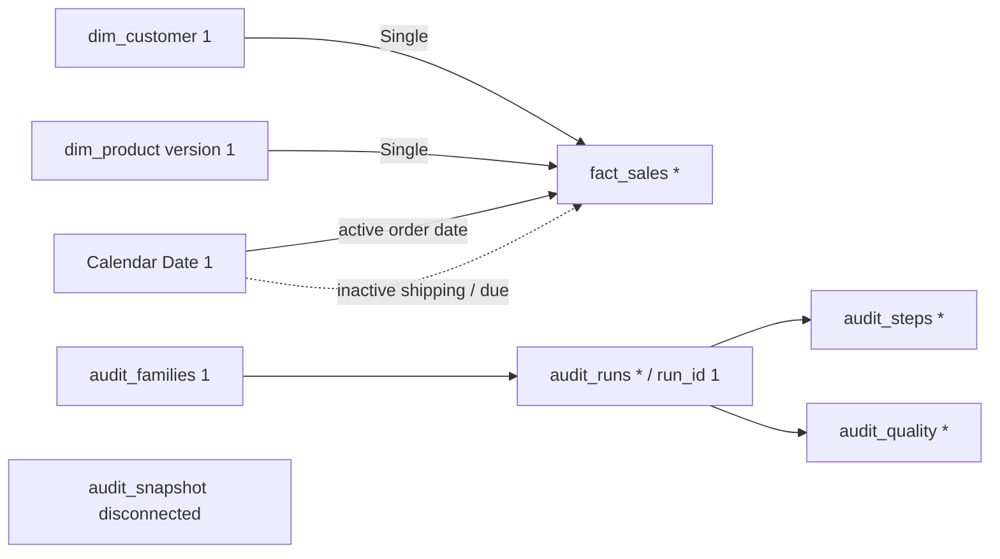

# Sales Performance & Data Reliability — model za Import

Status 6A: specifikacija i read-only SQL su pripremljeni; **nije kreiran/verifikovan PBIX/PBIP**.
Power BI Desktop 2.144.878.0 je instaliran i otvoren, ali UI kontrola/snimanje prozora nisu uspeli
(`coordinate input geometry is unavailable`, zatim `FrameArrived timed out`). Ni refresh ni DAX
nisu izvršeni. Postojeći PBIX/PBIP/PBIT u projektnom stablu nije pronađen niti prepisan.

## Tabele, grain i relacije

Importuj odvojene SELECT blokove iz [06_business_import.sql](sql/06_business_import.sql) i
[05_audit_import.sql](sql/05_audit_import.sql), sa imenima iz komentara. Ne spajaj audit sa prodajom.
Nema deployment skripte: nijedan pomoćni SQL view nije potreban.

| Tabela | Jedan red predstavlja | Tipovi / namena |
|---|---|---|
| fact_sales | Jednu Silver prodajnu stavku, sa multiplicitetom | Keys/quantity Whole number; sales_amount/price Fixed decimal number, format bez valute; source_*_date Date; order_number Text |
| dim_customer | Jednog kupca + unknown ključ 0 | customer_key Whole number jedinstven; country/gender/status aktuelni SCD1 atributi |
| dim_product | Jednu izvornu verziju proizvoda + unknown 0 | product_key Whole number jedinstven; product_number se ponavlja kroz verzije |
| dim_date | SQL date staging, uključuje unknown red | Disable Enable load; služi za pravljenje Calendar |
| Calendar | Jedan datum od 1. januara minimalne do 31. decembra maksimalne source date godine | Date bez NULL/duplikata/praznina; [Calendar.m](Calendar.m), sada 2010-01-01–2014-12-31 (1826 datuma) |
| audit_families | Jedan root run | family_id Text jedinstven; root_component omogućava izbor e2e |
| audit_runs | Jedan run, parent ili child | run_id Text jedinstven; family_id uključuje parent UUID ili sopstveni UUID za root |
| audit_steps | Jedan (run_id, ordinal) | Više koraka po run-u; duration_seconds Decimal |
| audit_quality | Jedan (run_id, check_id) | Warehouse registry nalazi; nije potpuna mart check istorija |
| audit_snapshot | Jedan red globalnog operativnog pregleda | Nepovezan; UTC datumi Date/Time, trajanje Decimal |

Relacije ručno postavi; obriši samo neželjene *automatski predložene relacije novog izveštaja*,
ne SQL objekte. Sve su **one-to-many, Single**, dimenzija filtrira fact:

| Jedan kraj → više kraj | Aktivna? |
|---|---|
| dim_customer.customer_key → fact_sales.customer_key | Da |
| dim_product.product_key → fact_sales.product_key | Da |
| Calendar.Date → fact_sales.source_order_date | Da, standardni poslovni datum |
| Calendar.Date → fact_sales.source_shipping_date | Ne; Sales by Shipping Date aktivira samo za tu meru |
| Calendar.Date → fact_sales.source_due_date | Ne; Sales by Due Date aktivira samo za tu meru |
| audit_families.family_id → audit_runs.family_id | Da |
| audit_runs.run_id → audit_steps.run_id | Da |
| audit_runs.run_id → audit_quality.run_id | Da |

Nema relacije Calendar–audit, audit–fact, dim_customer–dim_product, ni self-relacije parent/child.
Nema many-to-many ili Both filtera. U modelu sakrij tehničke key kolone i iznose postavi
Do not summarize za slučajno prevlačenje; izveštaj koristi eksplicitne mere.
Ne filtriraj dim_product na is_current=1: izgubila bi istorijske/unknown prodaje.
Jedinstvenost je na product_key, nikada na product_number. Fact_key nije trajni ID između refresh-a.

## Datumi i unknown bez gubitka prodaje

U Power Query-ju kreiraj Calendar iz [M fajla](Calendar.m). Ne koristi mart.dim_date direktno kao
marked date table jer ima NULL red sa date_key=0. Calendar je proširen na pune kalendarske godine;
na njemu: Table tools → Mark as date table → Date. Sort Month by Month Number; Year Month je yyyy-MM.
U ovom fajlu isključi automatski Auto date/time radi jednog jasnog kalendara (ne globalne postavke).

Fact source_order_date ostaje NULL kada nije poznat. Takvi redovi nemaju fizički datum u Calendar;
Power BI može prikazati implicitni blank član veze. Ne filtriraj ih iz fact-a i ne dodeljuj 1900 datum.
Ukupna Sales Amount bez date filtera uključuje sve redove. Vremenski trend ima samo datirane stavke;
obavezno prikaži zasebne kartice **Sales Without Order Date** i **Sales Amount Without Order Date**.
One namerno ignorišu Calendar filter (piši „All dates / undated”, ne „u izabranom mesecu”).

Date slicer na Overview počinje sa All; nije obavezan Between filter koji bi sakrio blank redove
iz ukupnih iznosa odmah pri otvaranju. Dodaj dugme/bookmark Reset filters. Na Reliability stranici
ne sinhronizuj date slicer. U trendu napiši da isključuje nepoznat order datum, a boundary periodi
nisu puni. Pregled „unknown historical category” ostaje vidljiv i u category chart-u i u ukupu.

Postoji 13 porudžbina sa stavkama koje imaju poznat i NULL order datum. Broj Orders je DISTINCTCOUNT
u tekućem kontekstu; zbir Orders preko datuma/kategorija nije ukupan broj porudžbina. Nema dokaza da
te stavke treba premestiti na datum drugih stavki: poslovna pravila ne menjamo.

## Audit i osvežavanje

Audit slicer: audit_families.family_id, Single select; root_component=e2e samo na detaljnoj
E2E istoriji. Audit_runs tabela tada prikazuje parent+child redove. Za operativne kartice koristi
nepovezani audit_snapshot, ne JOIN mnoštva quality/step redova sa prodajom. Raw error/summary tekst
se ne importuje. Ne sabiraj anomaly_count preko različitih check-ova (mogu opisivati iste redove).

„Last Confirmed Mart Completion UTC” je završetak poslednjeg PASS mart child-a, **proxy poslednje
potvrđene objave**, ne tačan COMMIT timestamp. Standalone mart runner nema ovu audit istoriju;
manual SQL/prekid/audit failure mogu ostaviti noviji mart bez potvrđenog zapisa. PASS child je važan
i ako parent naknadno padne. Ne prikazuj parent FAIL kao dokaz rollback-a mart-a. Svežina izveštaja
je observed_at_utc pri BI importu; nije vreme SQL load-a. Poslovni datumi 2010–2014 nisu dokaz
„zastarelosti” edukativnog dataseta. UTC jasno napiši na karticama; SQL datetime nema ugrađen offset.

Refresh radi kada nema aktivnog writer-a. Import više tabela nije automatski jedna SQL snapshot
transakcija: paralelna publikacija između čitanja može dati neusklađen BI snimak. Ako se audit
promeni tokom refresh-a ili reconciliation ne odgovara, sačekaj kraj load-a i ponovi Import refresh.

## Provera pre prikazivanja mentoru

Bez filtera uporedi sve KPI-jeve sa [SQL rezultatom](../docs/PHASE_6A_RESULTS.json), zatim:

1. Category tabela sabira se na Sales Amount zajedno sa unknown. Calendar trend + undated amount
   vraćaju ceo iznos; **ne** sabiraj distinct Orders/Purchasing Customers između grupa.
2. Izaberi 2013: proveri SQL sa istim datumskim granicama. Repeat se iznova računa u 2013, ne lifetime.
3. Mesečni chart mora dati BLANK MoM na boundary/partial selection; godišnji YoY samo za punu godinu
   i podržanu prethodnu godinu. BLANK označi „Not comparable”, ne 0%.
4. Audit family slicer menja audit tabele, nikada Sales Amount. Product slicer ne menja audit kartice.
5. Poredi sa [03_reconciliation.sql](sql/03_reconciliation.sql); proveri slicere, single filter smer
   i cardinality ako join duplira redove. Nikad ne „popravljaj” KPI uklanjanjem unknown prodaje.

Ovi koraci su acceptance plan za Desktop; nisu tvrdnja da su već izvršeni u DAX engine-u.
